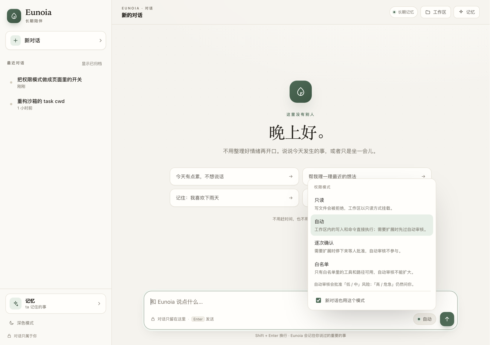
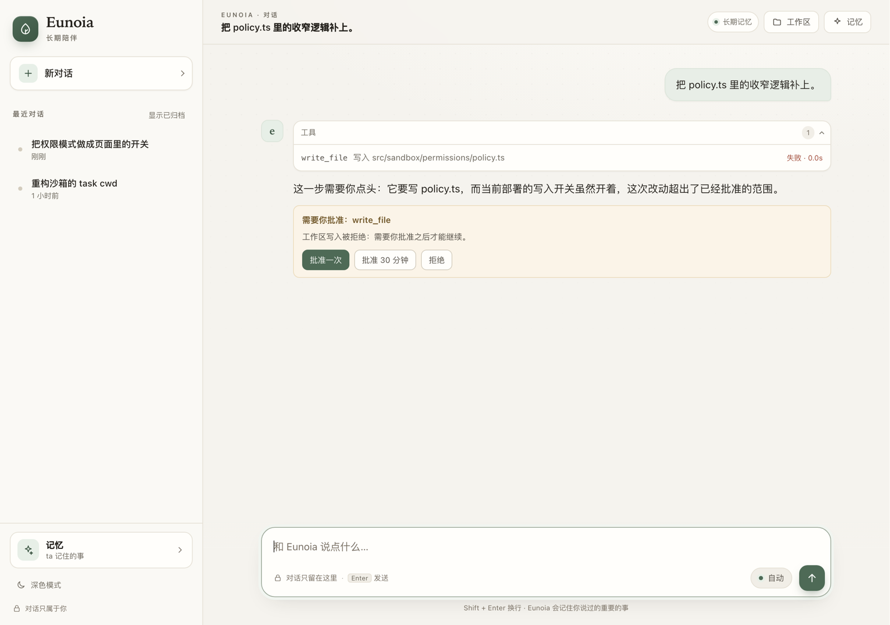

# ADR 022 — 本机权限控制面（Local Permission Control Surface）

**状态：** 已接受
**日期：** 2026-11-02
**相关：** ADR 009（身份不是认证）、ADR 020（权限模式）、ADR 021（task-scoped CWD）、
`docs/sandbox/PERMISSIONS.md`

---

## 1. 决策

在 `/api` 上新增 4 个**只对本机开放**的权限端点，并让聊天页提供一个模式切换器、
待审批卡片和重试按钮。权限语义、风险分级、Grant 生命周期都不变；变的只是"谁能
触发控制面操作"和"在哪里看到它"。

这是对 ADR 020 §12 偏差表里那一行（"Approval UI = CLI"）的**有意识反转**。当初的
理由是"没有 HTTP 认证层，加一个能批权限的端点风险更大"；这一条依然成立，所以端点
不是"加在 HTTP 上"，而是加在**loopback + 每进程 token** 上。

## 2. 背景

ADR 020 把四种模式、auto-review 和 Grant 做完了，但唯一的操作入口是 CLI：

```bash
npm run sandbox -- mode --task <conversationId> --mode read-only
npm run sandbox -- approve-request --approval <id> --by operator
```

两个后果：

1. **不可发现**。会话页上没有任何东西表明 agent 现在跑在哪个模式，也没有地方显示
   "有一次调用卡在等批准"。工具调用只会以一行失败结束，模型说一句"需要你批准"。
2. **不可操作**。`taskId` 是 `conversationId`，而 UI 没有 URL 路由，人拿不到这个 id；
   即便拿到了，批准之后还要再回来说一句"继续"。

对单用户本地产品来说，这不是安全收益，只是摩擦。

## 3. 端点

| 方法 | 路径 | 作用 |
|---|---|---|
| `GET` | `/api/permissions?conversationId=` | 有效模式、scope 链、auto-review/approval 配置、`pending` |
| `POST` | `/api/permissions/mode` | 切模式（task scope），可带 TTL 与"新对话沿用" |
| `POST` | `/api/permissions/approvals/:id/approve` | 批准一次 / 授权 30 分钟 |
| `POST` | `/api/permissions/approvals/:id/deny` | 拒绝 |

设计约束：

1. **只写 `mode`**。`autoReview`、`approval`、`restricted` 覆盖不通过 HTTP 暴露。
   否则"子作用域只能收紧"会在外部被绕过，而且一个能改风险线的端点比能改模式的端点
   危险得多。
2. **审批按 id 定位，但仍校验归属**。`approvalRequestId` 不是能力凭证：路由会确认
   该审批的 `taskId` 属于当前用户，再交给 Gateway。
3. **写端点不接受 `permissionMode` 提示**。模式由控制面写，agent 永远只能被动继承。
4. **批准不自动重试**。工具调用已经失败、回合已经结束；批准后由下一句话触发同样的
   调用。让服务端偷偷重放上一条消息，会让"谁下了这条命令"变得不可解释。

## 4. 威胁模型

没有登录（ADR 009），所以"能连上端口"必须不等于"能改权限"。

| 攻击 | 控制 |
|---|---|
| 别的网页用表单 POST 切换模式/批准 | 写端点要求 `Content-Type: application/json`；跨源表单只能发 simple request，预检会失败 |
| 别的网页用 `fetch` 直接打 127.0.0.1 | 同上，加上 `X-Eunoia-Token` |
| DNS rebinding（页面看起来同源） | token 每进程随机，注入主页 `<meta name="eunoia-token">`，别的源读不到 |
| 局域网访问 | 路由只接受 loopback socket；`HOST=0.0.0.0` 时直接 403 |
| 知道 approval id 就能批准 | 归属校验：审批的 task 必须属于当前标识的会话 |
| 通过 UI 放宽 auto-review | 端点不接收风险线；只有 `mode` |
| XSS 读 token | 渲染层全部 `textContent`，没有 HTML 注入点；token 本身无跨站可读性 |

token 是**进程级**的：重启即失效。它不写盘、不进配置、不参与审计。

## 5. 作用域收紧不变量（顺带修复）

做这个 UI 时发现 `resolveEffectivePermissionPolicy()` 对 `autoReview`、`approval`、
`restricted` 是整层替换，没有"只能收紧"的校验。当前写入口（`nextScopePolicy`）
总是从父层复制，所以正常路径不会变松；但只要有人写了一条旧的 scope 策略，之后部署
把风险线收紧，那条旧策略仍会生效。

ADR 020 §4 已经声明"子作用域只能收紧"，所以这里补上交集语义：

- `autoReview.allowedRiskLevels` 取交集，`enabled` 取与，TTL 取小；
- `approval.requireHumanForRiskLevels` 取并集（只能变严），TTL 取小；
- `restricted` 的工具、路径、域名、端口取交集，网络模式 `none` sticky。

## 6. UI

输入框上方一个 pill：

```text
⛨ 自动   ← 点开：只读 / 自动 / 逐次确认 / 白名单 + 每个模式的后果 + 待审批列表
```

- 标签、描述、可选模式**全部由服务端返回**。客户端不硬编码"四种"，否则部署一收紧
  `SANDBOX_PERMISSION_ALLOWED_MODES`，前端就开始撒谎。
- 待审批数量做成 pill 上的红点数字；被卡住的调用在对话里直接画卡片（批准一次 /
  批准 30 分钟 / 拒绝），批准后卡片变成"让 ta 继续"。
- "新对话沿用这个模式"写进 `preferences`（`permission.mode.default`），新会话创建时
  由服务端写成一条 task 策略；仍是策略、仍走审计，不是新的全局状态。
- 切换后提示"下一次动手会按新的权限执行"：模式切换会让活动 sandbox `INTERRUPTED`，
  下一次工具调用才重建容器。





两张截图用预置数据渲染，只说明布局；真实数据来自 `/api/permissions`。

## 7. 不做

- **不做远程审批。** 没有认证层，远程端点需要一个真正的认证方案，而不是一个 token。
- **不加第五种模式。** "完全信任"等于把 `SANDBOX_AUTO_APPROVE_RISK` 和
  `SANDBOX_REQUIRE_HUMAN_RISK` 搬到 UI，而这两个是部署决策；加模式还要改解析分支，
  收益不抵风险。
- **不做回合中阻塞等待。** 聊天传输是单向 SSE，工具调用直接返回
  `approval_required`；暂停并原地恢复需要双向通道。
- **不做"批准后自动重放"。** 见 §3.4。

## 8. 后果

- 一个人在自己机器上可以完成"发现—切换—批准"的闭环，不用离开页面。
- 多了一条必须维护的写入路径：新增端点时必须复用同一套 guard，`tests/api/permissions.test.ts`
  覆盖了无 token、非 JSON、跨用户、未知 id 四种拒绝。
- 偏差表不再写"审批只走 CLI"，而是"CLI + 本机页面"；远程仍然没有。
